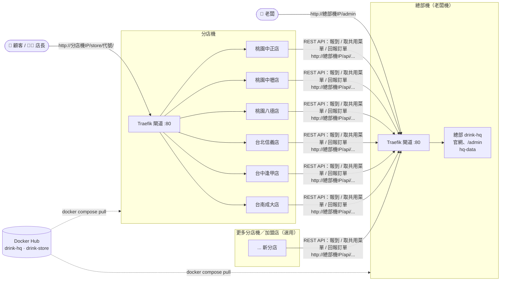

# 🧋 開心飲品｜連鎖飲料店分散式系統

這是一個使用 **Docker** 和 **Docker Compose** 建置的連鎖飲料店分散式平台。映像檔放在 **Docker Hub**，**總部（老闆機）和分店（分店機）分別部署在不同的 Ubuntu 虛擬機**，分店透過網路向總部報到、同步菜單、回報營收；可以**一行指令新增分店**，也可以再加開更多台分店機。

| 老闆的需求 | 系統怎麼做 |
|---|---|
| 各分店版面、操作介面一致，菜單相同，突顯品牌形象 | 所有分店都使用**同一個 `drink-store` 映像檔**和同一份品牌樣式，共用菜單統一由總部發布 |
| 各分店有獨立網站，可以新增自己的特色飲品 | 每間分店是**獨立容器**，有自己的網址 `/store/<代號>/` 和資料庫；店長可以在後台新增特色飲品並上傳產品圖 |
| 新開台北、台中、台南，之後開放加盟 | 分店清單集中在分店機的 `stores.csv`，執行 `add-store.sh` 就能新增，**不用改任何程式**；加盟主也可以自己開一台分店機 |
| 老闆掌握所有分店的營收 | 分店會自動把訂單回報給**總部機**，老闆在總部後台看全品牌、各城市、各分店的營收 |
| 店長知道自己分店的經營資訊 | 每間分店有**店長後台**：今日／累計營收、客單價、品項排行、近 14 日趨勢 |

---

## 1. 系統架構

系統分成兩種機器，各自是一台 Ubuntu 虛擬機：

| 角色 | 跑哪些容器 | 誰在用 |
|---|---|---|
| **總部機（老闆機）** | Traefik 閘道 + 總部 `drink-hq` | 老闆：品牌官網、營收總覽、共用菜單 |
| **分店機** | Traefik 閘道 + `stores.csv` 裡的分店 `drink-store-*` | 顧客點餐、店長後台 |



### 分散式設計重點

| 設計 | 說明 |
|---|---|
| **總部與分店分機部署** | 總部機只跑總部，分店機只跑分店；兩邊只透過 HTTP REST API 溝通，不共用資料庫或硬碟 |
| **一份映像檔，多個實例** | N 間分店都使用 `drink-store` 映像檔，只靠環境變數區分，所以版面一定一致 |
| **資料各自獨立** | 每個容器有自己的 SQLite 資料庫和 Docker volume；分店存特色飲品、訂單、產品圖，總部存共用菜單和彙總營收 |
| **服務自動發現** | 分店啟動後會主動向總部**報到**，總部的門市清單自動更新；Traefik 透過 Docker labels **自動**建立 `/store/<代號>` 路由 |
| **容錯** | 總部機斷線時分店**照常營業**，會使用本地快取的菜單，訂單也先暫存；總部恢復後自動補傳，不會重複計算 |
| **單一入口** | 每台機器都只走 80 port，不需要為每間分店開一個 port，分店數量不受 port 限制 |
| **水平擴充** | 分店機可以開不只一台（例如每個城市一台、加盟主自己一台），全部指向同一台總部機即可（見第 4.4 節） |

### 目錄結構

```
.
├── docker-compose.yml          # 閘道 Traefik（總部機、分店機都會用到）
├── docker-compose.hq.yml       # 總部服務（只在總部機）
├── docker-compose.stores.yml   # 分店服務（只在分店機，由 stores.csv 自動產生）
├── stores.csv                  # ★ 分店清單：代號、名稱、城市、店長密碼
├── .env.hq.example             # 總部機的環境變數範本
├── .env.store.example          # 分店機的環境變數範本
├── hq/                         # 總部服務原始碼 + Dockerfile
├── store/                      # 分店服務原始碼 + Dockerfile（所有分店共用）
├── shared/
│   ├── brand.css               # 品牌統一樣式（總部與分店共用）
│   ├── seed_specials.json      # 各分店預設的特色飲品
│   └── drinks/                 # 產品圖
└── scripts/
    ├── build-push.sh           # 打包映像檔並上傳 Docker Hub
    ├── gen-stores.sh           # stores.csv → docker-compose.stores.yml
    ├── add-store.sh            # 一鍵新增分店（分店機）
    ├── remove-store.sh         # 停用分店（分店機）
    └── demo_orders.sh          # 產生示範訂單（分店機）
```

### 網址一覽

以下以總部機 IP `192.168.1.10`、分店機 IP `192.168.1.20` 為例，請換成你自己的 IP。

| 頁面 | 網址 | 帳號／密碼（預設） |
|---|---|---|
| 品牌官網（門市據點） | http://192.168.1.10/ | — |
| 總部後台（老闆） | http://192.168.1.10/admin | `boss` / `boss1234` |
| 總部機 Traefik 閘道監控 | http://192.168.1.10:8080/ | — |
| 桃園中正店 | http://192.168.1.20/store/taoyuan1/ | 店長 `manager` / `ty1pass` |
| 桃園中壢店 | http://192.168.1.20/store/taoyuan2/ | `manager` / `ty2pass` |
| 桃園八德店 | http://192.168.1.20/store/taoyuan3/ | `manager` / `ty3pass` |
| 台北信義店 | http://192.168.1.20/store/taipei/ | `manager` / `tpepass` |
| 台中逢甲店 | http://192.168.1.20/store/taichung/ | `manager` / `tchpass` |
| 台南成大店 | http://192.168.1.20/store/tainan/ | `manager` / `tnnpass` |
| 分店機 Traefik 閘道監控 | http://192.168.1.20:8080/ | — |

店長後台在各分店網址後面加 `manager`，例如 `/store/taipei/manager`，或點右上角的「店長登入」。

### 菜單

**共用飲品**（所有分店都有，由總部統一管理）：開心奶茶 70 元、快樂紅茶 55 元、烏龍綠茶 60 元、茉莉花茶 70 元、甘蔗青茶 65 元

**各分店特色飲品**（預設內容，店長可以自行增刪）：

| 分店 | 特色飲品 |
|---|---|
| 桃園中正店 | 拉拉山水蜜桃烏龍 75、黑糖珍珠鮮奶 80 |
| 桃園中壢店 | 客家擂茶拿鐵 80、桔醬檸檬綠 65 |
| 桃園八德店 | 埤塘蓮花青茶 70、芋頭西米露奶茶 80 |
| 台北信義店 | 文山包種奶蓋 75、貓空鐵觀音拿鐵 80 |
| 台中逢甲店 | 大甲芋頭鮮奶 85、梨山高冷烏龍 70 |
| 台南成大店 | 麻豆文旦青茶 70、玉井芒果冰沙 85 |

---

## 2. 部署步驟

> 適用 Ubuntu 22.04／24.04。以下指令都用一般使用者（例如 `ubuntu`）執行。
>
> **請準備兩台虛擬機**：一台當總部機、一台當分店機。兩台要能互相連線：
> - 兩台虛擬機在**不同實體電腦**上：VMware 網路請設成**橋接（Bridged）**，並連在同一個網路。
> - 兩台虛擬機在**同一台實體電腦**上：用 NAT 或橋接都可以。
>
> **建議順序：先部署總部機，再部署分店機。**

### 2.0 兩台都要做：安裝 Docker 並下載專案

**Step 1：安裝 Docker、Docker Compose 和 Git**

```bash
sudo apt-get update
sudo apt-get install -y ca-certificates curl git
sudo install -m 0755 -d /etc/apt/keyrings
sudo curl -fsSL https://download.docker.com/linux/ubuntu/gpg -o /etc/apt/keyrings/docker.asc
sudo chmod a+r /etc/apt/keyrings/docker.asc
echo "deb [arch=$(dpkg --print-architecture) signed-by=/etc/apt/keyrings/docker.asc] https://download.docker.com/linux/ubuntu $(. /etc/os-release && echo "$VERSION_CODENAME") stable" | sudo tee /etc/apt/sources.list.d/docker.list > /dev/null
sudo apt-get update
sudo apt-get install -y docker-ce docker-ce-cli containerd.io docker-buildx-plugin docker-compose-plugin
```

讓目前的使用者不用 `sudo` 就能使用 docker：

```bash
sudo usermod -aG docker $USER
newgrp docker
```

確認安裝成功：

```bash
docker --version && docker compose version
```

**Step 2：下載專案**

```bash
git clone https://github.com/1257244/midterm_exam1120.git
cd midterm_exam1120
```

**Step 3：查詢這台機器的 IP**（之後設定會用到）

```bash
hostname -I
```

### 2.1 總部機（老闆機）

**Step 4：建立總部機設定**

```bash
cp .env.hq.example .env
nano .env
```

`DOCKERHUB_USER` 預設為 `alexliu0814`，會直接從 Docker Hub 下載已發布的映像檔（[drink-hq](https://hub.docker.com/r/alexliu0814/drink-hq)、[drink-store](https://hub.docker.com/r/alexliu0814/drink-store)），**不需修改即可部署**。正式使用時，請把 `HQ_API_KEY` 改成一串亂數，並記下來，等一下分店機要填同一串；`SECRET_KEY` 和老闆密碼也請一併修改。

**Step 5：啟動總部**

```bash
docker compose pull
docker compose up -d
docker compose ps
```

應該只會看到 `drink-gateway` 和 `drink-hq` 兩個容器，狀態都是 `Up`。

用瀏覽器打開 `http://<總部機IP>/`，會看到品牌官網；這時還沒有分店，門市據點是空的。

### 2.2 分店機

**Step 4：建立分店機設定**

```bash
cp .env.store.example .env
nano .env
```

一定要修改這三個值：

| 變數 | 填什麼 | 範例 |
|---|---|---|
| `HQ_URL` | 總部機的網址 | `http://192.168.1.10` |
| `STORE_BASE_URL` | 這台分店機自己的網址（結尾不要加 `/`） | `http://192.168.1.20` |
| `HQ_API_KEY` | 和總部機 `.env` 裡的 `HQ_API_KEY` **一模一樣** | `change-me-api-key` |

先確認分店機連得到總部機：

```bash
curl http://<總部機IP>/healthz
```

有回應 `{"service":"hq","status":"ok"}` 才繼續；連不到請先檢查虛擬機網路設定（見第 8 節）。

**Step 5：啟動分店**

```bash
docker compose pull
docker compose up -d
docker compose ps
```

應該會看到 `drink-gateway` 和 6 個 `drink-store-*` 容器，狀態都是 `Up`。

### 2.3 確認兩台連起來了

約 30 秒後：

- 打開總部官網 `http://<總部機IP>/`，6 間門市都會顯示「營業中」，點下去會連到分店機的網址。
- 登入總部後台 `http://<總部機IP>/admin`，「分店連線」會顯示 6 / 6。
- 登入任一分店的店長後台，例如 `http://<分店機IP>/store/taipei/manager`，「總部連線」會顯示「正常」。

> 💡 從實體電腦連不到虛擬機：確認實體電腦 ping 得到虛擬機 IP；虛擬機若有開防火牆，執行 `sudo ufw allow 80/tcp`，再執行 `sudo ufw allow 8080/tcp`。

---

## 3. 打包映像檔並上傳 Docker Hub

修改程式或新增產品圖後，用下面的步驟重新打包並發布（在任一台裝好 Docker 的機器上執行，需要先建立 `.env`）：

```bash
docker login
```

```bash
bash scripts/build-push.sh --push
```

腳本會從專案根目錄 build 兩個映像檔，並上傳到 Docker Hub：

- `<DOCKERHUB_USER>/drink-hq:latest`：總部
- `<DOCKERHUB_USER>/drink-store:latest`：分店（所有分店共用）

在總部機和分店機上分別更新到新版：

```bash
docker compose pull && docker compose up -d
```

---

## 4. 擴充分店（★ 支援無限擴店）

以下指令都在**分店機**上執行，總部機不需要任何操作。

### 4.1 新增分店：一行指令

```bash
bash scripts/add-store.sh kaohsiung 高雄左營店 高雄市 khhpass
```

這個指令會自動完成：

1. 把新分店寫入 `stores.csv`
2. 重新產生 `docker-compose.stores.yml`
3. 用同一個 `drink-store` 映像檔啟動新容器
4. 分店機的 Traefik **自動**建立路由 `http://<分店機IP>/store/kaohsiung/`
5. 新分店**自動**向總部報到，出現在官網的門市據點和老闆的營收儀表板

**總部機、其他分店都不需要修改或重新啟動。**

### 4.2 批次新增

直接編輯 `stores.csv`，一次加入多筆：

```csv
taoyuan4,桃園龜山店,桃園市,ty4pass
hsinchu,新竹巨城店,新竹市,hsinpass
```

然後重新產生設定並啟動：

```bash
bash scripts/gen-stores.sh && docker compose up -d
```

### 4.3 停用分店

```bash
bash scripts/remove-store.sh kaohsiung
```

分店資料預設會保留；加上 `--purge` 會連資料一起刪除。之後可以到總部後台的分店明細頁，把它從門市清單移除，歷史營收會保留。

### 4.4 再加開一台分店機（例如加盟主）

每台分店機都是照第 2.0 和 2.2 節部署，指向**同一台總部機**即可。唯一要注意的是：**每台分店機的 `stores.csv` 不能有重複的分店代號**。

例如第二台分店機只放加盟店，就把它的 `stores.csv` 改成：

```csv
store_id,name,city,manager_password
franchise1,加盟一號店,新北市,fr1pass
franchise2,加盟二號店,新竹市,fr2pass
```

然後執行：

```bash
bash scripts/gen-stores.sh && docker compose up -d
```

啟動後，這幾間加盟店會自動出現在總部的門市清單和營收儀表板。

---

## 5. 功能操作與驗證

### 5.1 產生示範訂單（分店機）

```bash
bash scripts/demo_orders.sh localhost 5
```

這個腳本會對這台分店機上的每間分店各下 5 筆訂單。約 30 秒後重新整理總部後台 `http://<總部機IP>/admin`，就能看到營收。

### 5.2 老闆：總部後台 `http://<總部機IP>/admin`

- **KPI**：今日營收、累計營收、平均客單價、分店連線數
- **近 14 日營收**、**各城市營收**長條圖
- **各分店營收表**：可以依城市篩選、搜尋、排序、只看離線分店；分店再多也方便管理
- **熱銷品項 Top 10**、**分店特色飲品排行**
- **分店明細**：每間分店的品項銷售、近 14 日營收、最近訂單
- **共用菜單**：修改價格／說明、上下架、新增品項；**全部分店 30 秒內自動同步**

### 5.3 店長：分店後台 `http://<分店機IP>/store/<代號>/manager`

- 本店今日／累計營收、客單價、待回報總部的訂單數、總部連線狀態
- 近 14 日營收、品項銷售排行、最近 15 筆訂單
- **特色飲品管理**：新增、修改價格與說明、**上傳產品圖**、上下架、刪除

### 5.4 顧客：分店首頁 `http://<分店機IP>/store/<代號>/`

- 「本店限定特色飲品」和「品牌經典飲品」
- 用 ＋／− 選擇數量，下方購物車列即時顯示杯數和金額，送出後顯示訂單明細

### 5.5 驗證分散式容錯

在**總部機**上停掉總部：

```bash
docker compose stop hq
```

這時到任一分店網站下單，仍然可以正常點餐；店長後台會顯示「總部連線：離線」，訂單標示「待回報」。品牌官網和總部後台會暫時無法使用，但分店不受影響。

也可以直接把總部機關機，效果相同。

在**總部機**上重新啟動總部：

```bash
docker compose start hq
```

30 秒內，分店會自動把暫存的訂單補傳給總部。

---

## 6. 產品圖

產品圖放在 `shared/drinks/`，檔名對照表請看 [shared/drinks/README.md](shared/drinks/README.md)。放入圖片後執行 `bash scripts/build-push.sh --push`，重新打包並發布即可。還沒有圖片的品項會自動顯示表情符號和漸層色塊。

新分店的特色飲品，店長可以直接在後台上傳產品圖。圖片存在該分店自己的 volume，不需要重新打包映像檔。

---

## 7. API 一覽（總部）

| Method | 路徑 | 說明 | 驗證 |
|---|---|---|---|
| GET | `/api/menu` | 取得共用菜單 | 無 |
| GET | `/api/stores` | 門市清單與連線狀態 | 無 |
| POST | `/api/stores/register` | 分店報到 | `X-API-Key` |
| POST | `/api/orders` | 分店回報訂單（重送的訂單會自動忽略） | `X-API-Key` |
| GET | `/api/summary` | 各分店營收摘要 | `X-API-Key` |
| GET | `/healthz` | 健康檢查 | 無 |

```bash
curl http://<總部機IP>/api/menu
```

```bash
curl -H "X-API-Key: change-me-api-key" http://<總部機IP>/api/summary
```

---

## 8. 常用指令與常見問題

| 目的 | 指令 |
|---|---|
| 查看這台機器的容器狀態 | `docker compose ps` |
| 查看某分店日誌（分店機） | `docker compose logs -f store-taipei` |
| 查看總部日誌（總部機） | `docker compose logs -f hq` |
| 停止這台機器的服務 | `docker compose down` |
| 停止並**清除這台機器的所有資料** | `docker compose down -v` |
| 更新到最新映像檔 | `docker compose pull && docker compose up -d` |

| 狀況 | 解決方式 |
|---|---|
| `DOCKERHUB_USER` 未設定的錯誤 | 確認已依機器角色執行 `cp .env.hq.example .env` 或 `cp .env.store.example .env` |
| `no configuration file provided` | 確認 `.env` 裡有 `COMPOSE_FILE=...`（範本內已寫好，請勿刪除） |
| `permission denied ... docker.sock` | 執行 `sudo usermod -aG docker $USER`，登出再登入 |
| 總部門市據點是空的／分店顯示「暫停服務」 | 分店剛啟動要等約 30 秒；在分店機執行 `docker compose logs store-<代號>` 查看錯誤 |
| 分店店長後台顯示「總部連線：離線」 | ① 在分店機執行 `curl http://<總部機IP>/healthz` 確認連得到；② 檢查分店機 `.env` 的 `HQ_URL`；③ 確認兩台的 `HQ_API_KEY` 完全相同。改完 `.env` 後執行 `docker compose up -d` |
| 兩台虛擬機互相 ping 不到 | 在不同實體電腦上時，VMware 網路要用**橋接（Bridged）**；NAT 模式下別台電腦連不進來 |
| 官網門市連結點了打不開 | 分店機 `.env` 的 `STORE_BASE_URL` 要填分店機的 IP（結尾不加 `/`），改完執行 `docker compose up -d` |
| 分店網址出現 404 | 分店剛啟動要等幾秒；用 `docker compose ps` 確認容器為 `Up`，再到分店機 :8080 的 Traefik 面板查看路由 |
| 80 port 被占用 | 停掉占用的服務（例如 `sudo systemctl stop apache2`），或在 `.env` 加上 `HTTP_PORT=8000` 改用其他 port（此時網址要加上 `:8000`） |

> **只有一台電腦，想先在單機上展示？** 把 `.env` 的 `COMPOSE_FILE` 設成 `docker-compose.yml:docker-compose.hq.yml:docker-compose.stores.yml`，並刪掉 `HQ_URL` 和 `STORE_BASE_URL` 兩行，總部和分店就會跑在同一台機器上。

---

## 9. 技術選用

| 項目 | 技術 |
|---|---|
| 後端 | Python 3.12、Flask、Gunicorn |
| 資料庫 | SQLite（每個服務一個，存在獨立的 Docker volume） |
| 閘道 | Traefik v3（Docker provider 自動服務發現） |
| 容器化 | Docker、Docker Compose |
| 映像檔倉庫 | Docker Hub |
| 部署環境 | Ubuntu 虛擬機 × 2（總部機、分店機） |

## 10. AI 輔助說明

本專案使用 AI 工具 (Claude Code) 協助：

- 根據需求分析，設計「總部機 + 分店機」分開部署的分散式架構與擴店機制
- 產生 Flask 程式碼、網頁介面、Dockerfile、docker-compose 設定與自動化腳本
- 規劃各分店特色飲品，撰寫 README 部署文件

AI 產生的內容皆經過人工檢查，並依照本文件步驟在 Ubuntu 虛擬機上部署驗證。
